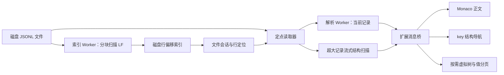

# 超大 JSONL 文件查看器：技术可行性与实施计划

分析日期：2026-10-07。调研开始时工作目录为空，本次仅完成调研和方案，不包含扩展实现或性能实测。下文性能数值均为估算或待验证目标。

## 1. 结论与推荐方案

四项需求均有可行的实现路径。推荐采用 **只读 Custom Editor + 后台字节偏移索引 + 当前记录按需读取 + Monaco JSON 正文 + 可点击的 key 结构缩略导航**。

核心原则：文件可以有 100 GB，首次优先提供前 100 行作为可浏览范围，但交给编辑器和 JSON 解析器的完整内容仍只来自当前选中记录；建立全文件行索引时只扫描换行符，不解析所有 JSON。

必须区分两种“快速”：

- **快速打开并浏览前 100 行**：不用等待全文件索引，优先扫描并开放前 100 行，边扫描边加入行选择列表；正文按需读取和展开选中的一行。后台从已有扫描位置继续建立全文件索引，不足 100 行时展示实际行数。
- **快速精确跳到任意行**：已有有效索引时可直接定位；首次打开、目标尚未被扫描时，需要扫描到该行。界面持续提示索引百分比、已扫描大小、已索引行数、速度和预计剩余时间。100 GB 文件在顺序读取基准为 500 MB/s、有效索引吞吐达到其 60%–80% 的假设下，预计约 4.2–5.6 分钟完成索引；这是规划估算，详见第 6.5 节，运行时以实际速度更新。

因此，“无索引的 100 GB 文件首次打开后，立刻精确跳到任意一行”不能作无条件承诺。变长 JSONL 没有内置行目录，无法仅凭行号计算字节位置。推荐体验是先开放前 100 行并持续扩大可访问范围，同时显示索引进度、允许输入任意行号；未索引目标进入可取消的等待，已索引范围继续可用。之后重复打开复用磁盘索引。

| 原始需求 | 实现方式 | 关键边界 |
| --- | --- | --- |
| 几十至上百 GB，快速打开 | 自定义文件模型、分块读、前 100 行优先、后台索引及进度提示 | 不把源文件作为完整 TextDocument 打开；初始 100 行也受字节缓存预算约束 |
| 每行 JSON 可正常折叠 | 选中行严格解析，格式化后提供对象/数组折叠 | 只解析当前行；无效 JSON 保留原文并报错 |
| 一次一行，可看任意行 | 物理行号 → 字节偏移 → 定点读取 | 首次未索引区需要等待；索引后定位不依赖目标行号大小 |
| key 缩略图，可展开 1–2 级 | 右侧语义导航，显示 key、类型、层级，点击定位 | 不是只有像素的代码 minimap；大数组、大量 key 也要分页/虚拟化 |

## 2. 范围与默认解释

初始浏览窗口为前 100 条 JSONL 记录，用户可通过行选择列表或上一行/下一行浏览这些记录；正文一次展开选中的一条，保持原始“每次一行”的交互。正文可展开成多行 JSON，工具栏的行号始终对应源文件物理行号。前 100 行只是优先加载范围，不限制索引后访问第 101 行及以后的内容。

首发范围建议：

- VS Code Desktop；macOS、Windows、Linux 上的本地普通文件。
- 未压缩、UTF-8 的 `.jsonl` / `.ndjson`；默认只读。
- 支持对象、数组和标量根节点；空白行仍占行号，但显示为无效记录。
- 首次优先开放前 100 行，显示初始范围就绪进度；全文件索引在后台继续，并展示百分比、速度与预计剩余时间。
- 上一行、下一行、输入行号、首行、末行；末行的精确行号在完整索引后确定。
- JSON 正文折叠、展开到 1/2 级、原始文本切换、当前记录内查找。
- key 导航默认展示一级，可切到二级；点击 key 定位并展开必要祖先。
- 自动保存索引；源文件有变化时使旧索引失效，不自动覆盖原文件。

暂不纳入首发：编辑保存、全文件全文检索、JSONPath 跨记录查询、排序筛选、gzip 直接随机访问、云端对象存储、浏览器版 vscode.dev。远程 SSH/容器支持作为单独验证项，不把任意 URI 都当作本地路径。

“最大单行有多大、节点有多少”是尚未给出的重要参数。总文件 100 GB、100 万行时，平均一行约 100 KB，但最大行可能远大于平均值。方案同时安排常规记录模式和超大记录模式；不能只测大量短行便宣称覆盖全部场景。

## 3. 两个参考插件的源码结论

调研固定到以下提交，避免后续上游变化影响结论。

### 3.1 lehoanganh298/json-lines-viewer

提交：`a1e779d1ecbde31b431f27d4aa742519e0efc82f`。

- 通过 `TextDocumentContentProvider` 生成当前行的 JSON 虚拟文档，再设置语言为 JSON；单行预览、上一行/下一行/跳行交互值得参考。
- `readFileAtLine` 每次从头创建流、逐行遍历到目标；反复跳到文件后部会重复读取前面的数据。
- 使用 `JSON.parse` 后再 `JSON.stringify`，没有解决超长记录与原始数值保真问题。

结论：可参考交互和“仅展示当前行”的思路，不适合作为大文件读取内核直接延用。[源码：extension.ts](https://github.com/lehoanganh298/json-lines-viewer/blob/a1e779d1ecbde31b431f27d4aa742519e0efc82f/src/extension.ts)

### 3.2 jsh9/quick-jsonl-viewer

提交：`1c218f16f4dca39227127c43d9e60844d8f579f7`。

- 使用 `CustomReadonlyEditorProvider`、流式扫描 LF 建立字节索引、按范围读取和 JSONL 记录级虚拟滚动，方向更接近本项目。
- `lineOffsets` 是内存 `number[]`；查看器重新加载会清空当前索引，所查实现没有磁盘索引复用。
- 索引模式等待所需范围建立完成后才发送 ready；小范围预览则走另一条读取路径。
- 范围读取按总字节长度分配缓冲区，随后完整解析和格式化记录；一次 `read` 的返回值也需要在本项目中按短读规则循环处理。
- 已有对象/数组折叠，但单条 JSON 展开后仍逐格式化行生成 DOM；跨记录虚拟化不能保证单条巨大 JSON 的渲染成本受控。

结论：重点参考索引、请求版本和折叠设计，重新实现持久化、渐进可读、单行预算和 key 导航。[索引与读取](https://github.com/jsh9/quick-jsonl-viewer/blob/1c218f16f4dca39227127c43d9e60844d8f579f7/src/jsonl/lineIndex.ts)、[加载流程](https://github.com/jsh9/quick-jsonl-viewer/blob/1c218f16f4dca39227127c43d9e60844d8f579f7/src/viewerData.ts)、[查看器状态](https://github.com/jsh9/quick-jsonl-viewer/blob/1c218f16f4dca39227127c43d9e60844d8f579f7/src/viewerProvider.ts)、[渲染](https://github.com/jsh9/quick-jsonl-viewer/blob/1c218f16f4dca39227127c43d9e60844d8f579f7/src/webview/app/render.ts)

建议独立实现核心，按需参考小模块。第二个仓库有 [MIT LICENSE](https://github.com/jsh9/quick-jsonl-viewer/blob/1c218f16f4dca39227127c43d9e60844d8f579f7/LICENSE)；第一个所查根目录和 manifest 未见许可声明，先仅参考设计。实际复制第三方代码时检查并保留相应许可信息。

## 4. VS Code 展示方案选择

| 方案 | 优点 | 局限 | 决策 |
| --- | --- | --- | --- |
| 当前记录虚拟文档 + 原生 JSON 编辑器 + TreeView | 原生折叠、快捷键、主题、查找，开发成本低 | 集成工具栏和右侧 key 缩略导航不够灵活；超长单条仍是完整文本模型 | 原型或简化版本的备选 |
| CustomReadonlyEditorProvider + Webview + Monaco | 自主管理读取，正文体验接近 VS Code，可集成导航 | 需要处理打包、主题、消息、worker、内存和编辑器生命周期 | **推荐主方案** |
| Webview + 自建虚拟 JSON 树 | 可按节点/数组页加载，适合超大单条 | 需自行实现选中、复制、键盘、无障碍和定位 | 超大记录的专用模式 |
| CustomTextEditorProvider 打开原始 JSONL | 可复用文本模型 | 仍让 VS Code 管理完整源文件，不符合本项目规模 | 不采用 |

`CustomReadonlyEditorProvider` 可自行定义文件模型，因此即使文件是文本，也适合这里“只保存 URI、文件句柄、索引和会话状态”的需求。`CustomTextEditorProvider` 则以完整 TextDocument 为模型。[VS Code Custom Editor API](https://code.visualstudio.com/api/extension-guides/custom-editors)

Monaco 必须作为扩展依赖本地打包，不能假设可以访问 VS Code 内部编辑器实例。只启用所需 JSON、折叠和查找能力；内置 minimap 是可选辅助，key 导航独立实现。[Monaco 官方项目](https://github.com/microsoft/monaco-editor)、[Monaco API](https://microsoft.github.io/monaco-editor/typedoc/)

## 5. 推荐架构



职责分离：

- **扩展主线程**：命令、文件会话、请求调度、进度和 Webview 通信，不做长时间同步扫描/解析。
- **索引 worker**：固定大小缓冲区扫描换行，批量写入偏移；与交互任务隔离，支持暂停、取消和恢复。
- **记录处理 worker**：有界读取、校验、格式化、生成 key/折叠位置。CPU 密集工作放入 worker；异步 I/O 本身不必因“异步”再创建大量线程。[Node worker_threads](https://nodejs.org/api/worker_threads.html)
- **Webview**：保存一个当前记录模型，只接收必要内容与导航元数据；消息携带文件版本和请求编号。
- **索引缓存**：独立于视图；同文件多个视图共享索引与读取服务，各自保留当前行和折叠状态。

打开流程：

1. `openCustomDocument` 只初始化轻量会话；不等完整索引，不调用源文件 `openTextDocument`。
2. 校验缓存；无有效缓存时，索引 worker 优先确定前 100 行的起止位置，分批向行选择列表发布已就绪记录，不必等满 100 行才响应。已有可用缓存时直接开放这 100 行，也可恢复上次行号。
3. 按选中行读取和解析正文；初始范围的原文字节缓存先以 32 MiB 为上限，超过时按需从已知偏移读取，不同时保留 100 份格式化结果或编辑器模型。单行逐块读取达到记录预算后转长行模式，不无限拼接。
4. 同一个扫描任务从已有位置继续建立全文件索引，持续刷新字节进度、已索引行数、吞吐量和 ETA；不从头重新扫描，也不单独再扫一遍统计总行数。前台读取和解析优先于后台扫描。
5. 已确定起止位置的行立即可读；目标未就绪时保留当前正文，提示目标行号和已索引范围，允许取消该跳转。初始范围中出现超长行时显示扫描进度，已就绪的前序行保持可用。
6. 索引完成并提交后总行数变为精确值，之后任意行直接定位；文件不足 100 行时按实际范围结束初始加载。

## 6. 字节索引与随机行访问

### 6.1 为什么优先完整索引

每条记录保存一个 64 位字节起点，末尾另存 EOF 哨兵，空间约为 `8 × (N + 1)` 字节。

| 行数 N | 偏移数组空间，不含元数据 |
| --- | --- |
| 10 万 | 0.76 MiB |
| 100 万 | 7.63 MiB |
| 500 万 | 38.15 MiB |
| 1,000 万 | 76.29 MiB |

用户给出的行数范围足以使用完整索引，没必要首先引入每隔几百行才存一个位置的稀疏索引。例如平均每行 100 KB、每 1,024 行一个检查点时，一次跳转仍可能追加读取约 100 MB。

索引落盘使用固定小端 `uint64`；内存使用分页 Buffer/typed array 或有上限的页缓存，避免每行一个 JS 对象以及整体扩容复制。JS `number` 对当前文件规模的字节位置可精确表示，转入 Node API 前检查 `Number.isSafeInteger`；不使用 32 位偏移或位运算处理文件位置。

### 6.2 扫描算法与行语义

- 使用异步定点读或流，每块初始取 4 MiB，P0 比较 1/4/8 MiB；搜索字节 `0x0A`，优先评估 `Buffer.indexOf`。
- 只记录 LF 后的实际下一行起点，不将字符串解码或整行拼接用于建立索引。
- 完成索引后，第 n 行范围为 `[offset[n-1], offset[n])`，UI 行号从 1 开始。
- 非空文件第一行从 0 开始；空文件行数为 0；末尾换行不额外制造一条空行；连续 LF 则保留中间空白行。
- CRLF 以 LF 分界，展示/解析前去掉该分隔符中的 CR；跨块 CRLF 一样处理。不把单独 CR 当作本方案的行分隔符。
- UTF-8 多字节字符不会包含 LF 字节；按字节找边界，再对完整记录或连续解码窗口解码。转义文本 `\\n` 不会被当成真实换行。
- 默认按严格 JSONL 验证；可容忍文件开头 BOM 并显式提示，但 BOM 的三个字节仍计入文件位置。非法 UTF-8 报错，不静默替换字符。
- 同时维护 `scannedBytes`、`completeLineCount` 和未结束行的起点；发现了行起点不等于这行已经可完整读取。
- 扫描限于会话开始时的文件版本和大小。只有到达该快照 EOF，才将无末尾换行的最后一行确认为完整读取范围。

这些行号约定符合 JSON Lines 的逐行 JSON 值语义；空白行不是合法 JSON 值。[JSON Lines 格式说明](https://jsonlines.org/)

### 6.3 精确定位与渐进索引

已索引目标只需读取两个偏移，再读取对应字节区间，复杂度约 `O(1) 定位 + O(L) 读取与解析`，其中 L 是当前记录长度。

没有索引时，扫描前缀的成本无法消除：

- 前台请求已覆盖范围：直接读取，并暂停/降低后台扫描 I/O 优先级。
- 前台请求未覆盖范围：登记等待目标，扫描从当前进度继续；一旦确定该行终点就响应，不必等整个文件完成。
- 快速连续跳行：只有最新请求可以替换正文；取消旧解析，但可保留仍有价值的全局索引任务。
- 越界：完整索引前显示“等待定位”；到达 EOF 后报告实际总行数，不悄悄展示别的行。
- 不用“平均行长 × 行号”冒充精确定位；若未来加入按字节百分比浏览，应明确那是另一种定位方式。

`read` 可能短读：循环累计实际 `bytesRead`，直到读满期望范围、取消或遇到 EOF；途中源文件变化进入失效流程。[Node FileHandle.read](https://nodejs.org/api/fs.html#filehandlereadbuffer-offset-length-position)

### 6.4 持久化、恢复和文件变化

缓存放在扩展可写存储目录，按规范化 URI（含远程 authority）生成键；不要求原文件目录可写。缓存仅保存索引与元数据，默认不保存 JSON 正文。

元数据至少包括：格式版本、源文件大小、mtime、可用的文件身份、首尾小段指纹、已提交扫描位置、完整行数、是否达到 EOF、索引页完整性信息。

- 页数据先写入，再原子提交可恢复检查点；完整索引以临时文件和原子替换提交。短写、磁盘满和损坏缓存均有明确处理。
- 部分索引只在已确定换行边界提交检查点，恢复时从安全边界继续。重新打开不会因上次有一条超长未完成行而误报行数。
- 页写入时完整校验；重新打开先校验头部与源文件身份，各页加载时再验证长度、校验码、偏移单调性和文件范围；失败则丢弃缓存并重建，避免为了打开缓存先读取全部索引页。
- 文件事件只是提示，打开、读前/读后和最终提交均结合 stat 检查；旧结果携带 generation，变化后不得覆盖新版本。
- 首发对追加、截断、替换、原地改写均采用失效重建，先保证正确性。后续纯追加优化必须处理“原末行没有 LF，新内容继续同一行”的情况。
- mtime、文件身份和抽样指纹属于快速校验，不能证明全文件未被刻意修改。首发性能假设是查看期间文件稳定；持续写入文件须显示变化状态，严格快照需外部快照/复制支持。
- 缓存有总容量与 LRU 清理规则；缓存目录不可写时转为当次会话索引，并提示下次需重建。

### 6.5 首次索引的耗时评估

文件大小比行数更直接地决定扫描时间。完整索引需要顺序读取所有字节，主要成本为读取、查找 LF 和索引落盘；JSON 解析不计入全文件索引。估算公式：

```text
有效索引吞吐 R_index ≈ 同环境顺序读取吞吐 R_read × 效率系数
完整索引时间 T ≈ 文件字节数 / R_index
剩余时间 ETA ≈ (文件字节数 - 已扫描字节数) / 近期实际索引吞吐
```

规划阶段先假设效率系数为 **60%–80%**，用于给扫描和索引写入预留开销，并非已测得的效率；最终提交还有少量额外耗时。下表采用十进制 GB/MB，各列是顺序读基准，不是 SSD 厂商标称峰值：

| 文件大小 | 顺序读 200 MB/s | 顺序读 500 MB/s | 顺序读 1,000 MB/s |
| --- | --- | --- | --- |
| 10 GB | 约 1.0–1.4 分钟 | 约 25–33 秒 | 约 13–17 秒 |
| 50 GB | 约 5.2–6.9 分钟 | 约 2.1–2.8 分钟 | 约 1.0–1.4 分钟 |
| 100 GB | 约 10.4–13.9 分钟 | 约 4.2–5.6 分钟 | 约 2.1–2.8 分钟 |
| 200 GB | 约 20.8–27.8 分钟 | 约 8.3–11.1 分钟 | 约 4.2–5.6 分钟 |

例如 100 GB / 500 MB/s 的纯读取下限为 200 秒；按上述效率系数折算后，规划预算为 250–333 秒。磁盘竞争、很多短行、冷缓存、外接设备或扫描被前台请求暂停都可能使实际时间超出区间，所以不能固定承诺“100 GB 几秒完成索引”。重复打开有效缓存时不再承担全文件扫描成本。

前 100 行的就绪时间取决于这 100 行的实际字节总量：平均每行 100 KB 时约 10 MB，以有效吞吐 300–400 MB/s 计算，单纯扫描约 25–33 ms；这不包含扩展激活、打开文件、IPC、解析和显示时间。若前 100 行合计 1 GB，单纯扫描就约需 2.5–3.3 秒；因此要渐进开放记录并限制缓存，不能只按“100 行”保证固定延迟。

评估落地方式：P0 用 1 GB 和 10 GB 的有效 JSONL 样本分别测纯顺序读和真实索引流程，覆盖短行、约 100 KB 行和长行混合分布；报告有效吞吐、写入开销、冷热缓存和前 100 行就绪时间，再修正效率系数。P5 用 50/100 GB 实际规模验证，避免仅由小文件暖缓存结果外推。

### 6.6 索引进度提示

查看器工具栏常驻进度条，VS Code 状态栏提供简短状态；索引过程不弹出阻塞对话框，不用持续通知打断阅读。提示示例：

```text
初始浏览范围：前 100 行已就绪，可立即选择查看
正在建立索引：42.0% · 42.0 / 100.0 GB · 已索引 420,000 行
当前速度：350 MB/s · 已用 2 分钟 · 预计剩余约 2 分 46 秒
[暂停索引] [取消索引]

跳转等待：正在定位第 900,000 行；目前可访问第 1–420,000 行
[取消本次跳转]
```

- **初始范围进度**与**全文件索引进度**分开：前者显示“前 100 行已就绪 37/100”，不足 100 行时显示实际总行数；后者按 `scannedBytes / snapshotSize` 计算，不用未知的总行数估算百分比。
- 每约 250 ms 合并刷新一次进度，ETA 每秒更新；吞吐采用最近约 10 秒的滑动平均或等效平滑方式。启动前 2–3 秒样本不足时显示“正在估算”，不输出虚假倒计时。
- 展示的已索引行数使用已知起止边界的完整行计数。超长行中百分比可以前进而行数不变，提示正在扫描该行。
- 未索引目标只显示当前可访问范围与全文件 ETA；不按平均行长给出看似精确的目标行等待时间。目标一旦就绪即跳转，无需等索引达到 100%。
- 暂停时显示“已暂停”，冻结 ETA，恢复后重新采样速度；取消本次跳转保留后台索引。取消索引保存安全检查点，已索引范围继续可用，并提供“继续索引”入口。
- 扫描到 EOF 后显示“扫描完成，正在保存索引”；提交成功再显示“索引完成，共 N 行，可跳转任意行”。空文件单独处理，不做除零计算。
- 文件变化、I/O 错误或缓存失效显示明确状态，不保留旧进度冒充当前任务。进度与结果同样绑定文件版本。

## 7. JSON 解析、折叠与超大单条

### 7.1 常规记录：保留源文本的解析

不能用 `JSON.stringify(JSON.parse(raw))` 作为显示内容的唯一来源：JS 数字转换可能改变超出安全整数范围的数值；重复 key 会丢失，部分 key 顺序和数值字面量也可能变化。

建议使用 `jsonc-parser` 的严格模式校验、词法位置和格式化能力，并始终保存原始文本作为值的来源：

- 禁止注释、尾逗号；检查错误列表，不能因容错解析返回了树就判定为合法 JSON。
- 格式化只变更 token 之间的空白，保留数值字面量、重复 key、属性顺序和字符串转义。
- 正文、复制原始记录和复制值都从原始 token/文本区间取值，不从 JS number 重建内容。
- 格式化之后重新计算有限元数据或建立位置映射；不能把原文偏移直接用于格式化后的正文定位。
- 使用词法扫描/visitor 建立折叠范围和一级/二级 key 元数据，尽量避免持有多套完整 AST。
- 折叠由对象/数组范围驱动，支持手动折叠、全部折叠、展开到 1/2 级。解析错误时展示原文、错误位置和源物理行号，不阻断跳行。

`jsonc-parser` 提供 scanner、visitor、带 offset 的树和文本格式化编辑操作；这些 API 本身不等于支持无限大输入，仍需记录级预算。[官方说明](https://github.com/microsoft/node-jsonc-parser)

位置类型必须区分：文件索引用 UTF-8 字节偏移；JS 字符串与 Monaco 范围使用 UTF-16 位置。中文、emoji 和转义 key 都要验证映射。

### 7.2 超大记录：独立的实现路径

只加载一行能控制总文件带来的内存增长，但单行仍可能有几十 MB 至 GB。Monaco 的可见行渲染不会消除完整文本模型、格式化结果和解析元数据的内存占用。

以下阈值只是 P0 的初始实验值，不能直接当成最终产品承诺：

| 记录条件 | 默认策略 |
| --- | --- |
| 原始行 ≤ 8 MiB，格式化后 ≤ 16 MiB，结构复杂度在预算内 | 常规 Monaco 模式 |
| 超过字节、节点、格式化膨胀或耗时预算 | 切换流式结构扫描 + 虚拟树 |
| 极端深度、语法损坏或结构扫描被取消 | 有界原文窗口、错误/未完成状态，仍可跳到其他行 |

超大记录模式是覆盖长行需求的正式工作项：

1. 对该行字节范围做增量词法/语法扫描，保留字符串转义、UTF-8 解码状态和显式容器栈；跳过大 value 的物化，但仍检查语法。
2. 先构建一级/二级字段位置；只保存有限页的子节点信息，更多边界索引可写临时文件。不能在内存中构造一个包含百万元素的完整 JS 对象。
3. 对象属性和数组子项按页展开，默认每页 100 项；数组元素位置按需扫描并缓存，不预先展开全部 DOM。
4. 巨大字符串/标量以分段文本窗口查看，可流式导出原始范围；提示当前是片段，不能把截断后的值冒充完整数据。
5. 结构未扫描完之前明确标识“校验中”；显示了部分 key 不代表整行已通过 JSON 校验。
6. 内存、深度、CPU 时间、单次消息大小都有上限；超限回退并保持界面可操作。worker 不是绝对内存隔离，不能只依赖其配置来处理任意大小输入。

完整校验超长记录仍需 `O(L)` 读取；首次发现后部字段也可能需要扫描前面的值。P4 完成前只能宣称“常规记录完整折叠、超长记录可安全预览”，不能宣称超长记录能力已完成。

### 7.3 内存和取消控制

- 每个视图最多一个活动 Monaco 模型；切行/关闭时 dispose 模型、装饰、监听器和旧解析结果。
- 只保留当前记录的完整编辑器模型；前 100 行的原文预取缓存初始上限为 32 MiB，按需填充和淘汰，缓存未命中的记录按已有偏移读取。其他邻近行预取后加，所有预取共享字节预算。
- 控制 raw、formatted、AST、worker 消息副本同时存活的峰值；消息分块并背压，不能连续发送多条巨大字符串。
- 解析采用有界任务；可分段算法在检查点取消，同步库调用无法及时取消时终止对应任务 worker 并重建。
- Webview 隐藏时保存少量状态，不默认永久保活全部内容；重新显示时按行号恢复。

## 8. key 缩略导航与交互

建议右侧为约 220–300 px 宽的“结构”面板，宽度可调整。正文仍展示标准格式化 JSON；右侧只显示 key、类型/数量提示和当前定位，便于长 value 场景下导航。

```text
data.jsonl  100 GB    第 [37] 行    [前100行 ▾] [上一行] [下一行] [跳转]
前100行已就绪 · 已索引420000行 · 42% · 350 MB/s · 预计剩余2分46秒
正文展开 [1级] [2级] [全部]                        [暂停索引]
┌───────────────────────────────────┬────────────────────────┐
│ {                                 │ 结构 [1级 / 2级]       │
│   "id": 9007199254740993,          │ id         number      │
│   "messages": [ … ],              │ messages   array(12)   │
│   "metadata": {                   │ metadata   object      │
│     "source": "...",              │   source   string      │
│     "tags": [ … ]                 │   tags     array(3)    │
│   }                               │                        │
│ }                                 │                        │
└───────────────────────────────────┴────────────────────────┘
```

具体规则：

- 根为深度 0；一级显示直接属性/数组项，二级再展示下一层。正文展开深度与导航展示深度是独立设置，初始正文展开到 2 级，导航显示 1 级。
- 对象字段按原文顺序排列；数组展示数量/已扫描数量和分页入口，不自动列出百万个元素。
- key 数量很大时，导航使用虚拟列表；只显示 1–2 级并不意味着节点数量一定少。
- 点击条目定位正文并高亮；若祖先折叠，只展开必要祖先，不重置其他折叠状态。超大记录模式则加载对应节点页。
- 正文光标/滚动变化时同步当前字段；采用节流更新，避免每次滚动重新解析。
- 内部节点 ID 使用位置/序号，路径用转义规则表达；重复 key 需要序号区分，不能只以字符串路径作唯一键。
- 标量根节点展示类型和值摘要；非法记录显示无法生成完整结构的原因。
- 切换行保留导航深度偏好；旧行折叠状态只在有界缓存内保存。

如还需要传统“代码缩略图”，可以额外启用 Monaco minimap；带 key 的结构导航作为本需求的核心交付。

## 9. 技术栈、模块与运行约束

建议栈：TypeScript、VS Code API、Node `fs/promises`、`worker_threads`、`jsonc-parser`、Monaco、esbuild。首版可用 TypeScript + DOM 编写工具栏与导航，不必为了这两个面板引入完整 UI 框架。

拟定模块：

```text
src/
  extension.ts
  editor/              # 只读 provider、文件会话、视图状态
  io/                  # 定点读取、短读循环、UTF-8 解码
  index/               # 扫描器、分页偏移、缓存、版本校验
  workers/             # 索引与当前记录处理入口
  json/                # 严格校验、保真格式化、位置、长行扫描
  protocol/            # 消息定义、参数校验、取消与请求版本
webview/
  editor/              # Monaco 管理及超大记录虚拟树
  outline/             # key 导航、虚拟列表、定位联动
  components/          # 行号工具栏、进度、错误状态
test/
  unit/
  integration/
  performance/
scripts/
  generate-fixtures.ts
  benchmark.ts
```

运行约束：

- 提供资源管理器右键入口，直接 `openWith` 自定义查看器，不先用文本编辑器加载大文件。开发期可注册为 option，发布时再决定是否默认接管扩展名；不悄悄覆盖用户已有编辑器关联。
- Webview 使用 `asWebviewUri`、本地静态资源和明确 CSP；原始 JSON/key 当作数据渲染，不插入可执行 HTML。worker 资源打包和加载方式必须在 P0 验证。[Webview API](https://code.visualstudio.com/api/extension-guides/webview)
- 消息只接受已打开文档的 session ID、行号、节点 ID；扩展端检查范围和请求版本，不接受 Webview 任意路径读写请求。
- 为远程文件处理预留 `extensionKind: ["workspace"]`；远程扩展运行位置、URI 和 Node 可读路径必须实际验证，不能用本机 `fs` 读取任意远程 URI。[远程扩展说明](https://code.visualstudio.com/api/advanced-topics/remote-extensions)
- 不把 `workspace.fs.readFile` 当作通用大文件分块读取回退；缺乏随机读能力的提供方明确显示不支持。
- 依赖版本与最低 VS Code 版本在 P0 锁定，并按 VS Code 内置 Node 版本编译/测试，不照搬参考仓库版本号或本机最新版 Node API。

## 10. 实施阶段与交付标准

以下按一名熟悉 TypeScript/VS Code 的开发者估算，阶段可迭代；不是已验证工期承诺。约 3–4 周得到覆盖常规记录的可用版本，包含长行模式与完整压力验证约 5–7 周。

| 阶段 | 预计投入 | 主要工作 | 通过条件 |
| --- | --- | --- | --- |
| P0：技术原型 | 2–3 天 | CustomReadonlyEditor、Monaco/worker 打包；1/4/8 MiB 扫描块比较；1/10 GB 索引基准及单条试验 | 测出前 100 行就绪时间与有效索引吞吐，校准耗时估算及常规记录预算 |
| P1：文件内核 | 4–5 天 | 前 100 行优先、渐进索引、进度/ETA、随机读取、缓存与恢复、取消 | 全量索引完成前可浏览前 100 行；进度真实且可暂停/继续；重复打开不重新全扫 |
| P2：单行 JSON 体验 | 3–4 天 | 初始行选择列表、工具栏、跳行、严格校验、保真格式化、折叠、无效行原文 | 前 100 行均可选择，且可继续访问后续行；记录保真；新请求不会被旧结果覆盖 |
| P3：key 缩略导航 | 2–3 天 | 1/2 级展示、虚拟列表、正文双向定位、数组分页入口 | 点击 key 正确定位，包含中文/emoji/重复 key，折叠时联动正确 |
| P4：超大记录模式 | 5–8 天 | 增量结构扫描、按需展开、数组分页、巨大值分段、预算和背压 | 单条 32/256 MiB 及更大样本不整条物化；可折叠导航，扫描可取消 |
| P5：验证与交付 | 4–6 天 | 10/50/100 GB 基准、跨平台、缓存失效、长时间切行、安装包和说明 | 达成下表目标或明确记录偏差；产出可安装 VSIX 与可复现报告 |

依赖顺序：P0 → P1 → P2 → P3；P4 复用 P1/P2 的读取、协议、位置模型；P5 全面验收。P0 若发现 Monaco 不满足普通记录预算，应先调整阈值/渲染方案，避免把问题带到完整开发后期。

原生虚拟 JSON 文档 + TreeView 是 P0 的降复杂度备选，不与主方案同时维护两套完整产品。超大记录模式则是数据规模要求驱动的独立路径。

## 11. 验收与测试计划

### 11.1 性能目标

先定义参考环境：桌面 VS Code、16 GB 内存、本地 SSD、稳定未压缩 UTF-8 文件、无其他重 I/O。报告记录系统、VS Code/Node 版本、磁盘和冷热缓存情况。以下为目标，不是当前结果。

| 指标 | 初始目标 |
| --- | --- |
| 查看器外壳可交互 | p95 < 500 ms，包含扩展激活需单独记录 |
| 无索引首次开放前 100 行，合计 ≤ 16 MiB、选中记录 ≤ 1 MiB 且在常规复杂度预算内 | p95 < 2 秒，含行选择列表就绪和选中记录显示，不等待全文件索引或同时格式化 100 条 |
| 初始范围含超长行或合计超过 16 MiB | 渐进开放已扫描记录、持续显示进度；单独报告耗时，不套用固定 2 秒目标 |
| 索引进度与 ETA | 进度约每 250 ms 合并刷新；ETA 每秒按平滑吞吐重算；已索引行数和字节范围可核对 |
| 有索引随机跳行，记录 ≤ 1 MiB | p95 < 300 ms，测量到正文和导航可交互 |
| 已加载记录折叠/导航 | 常规样本 p95 < 100 ms |
| 索引内核峰值内存 | 扫描缓冲区与索引页缓存合计控制在约 64 MiB 内 |
| 普通单视图增量内存 | 扩展相关 worker + Webview 增量目标 < 300 MiB，按进程去重计量 |
| 取消与快速切行 | 可分段任务 < 200 ms 响应；过期结果不得展示 |
| 重复打开 | 只校验和加载必要索引页，不因总文件大小再完整扫描 |
| 全文件索引吞吐 | 与同环境纯字节顺序读基准比较，目标 ≥ 60%，单独记录冷读/暖读 |
| 文件体积增加 | 固定记录与页缓存预算下，正文内存不随总文件大小线性增长 |

超大单条单独报告首段出现时间、结构扫描吞吐、峰值内存和取消延迟，不把 1 MiB 记录的延迟目标套到 256 MiB 记录。

### 11.2 正确性用例

- 空文件、单行、末尾有/无 LF、连续空白行、CRLF 跨块、首行 BOM。
- 文件不足 100 行、恰好 100 行、超过 100 行；前 100 行含空白/无效记录时仍按物理行号计数，不跳过错误行凑满 100 条。
- 前 100 行中间出现超长记录、总字节数超过预取预算；前序记录仍可访问，缓存淘汰后仍能重读，第 101 行及以后不被初始窗口限制。
- 中文/emoji 跨读取块、非法 UTF-8、字符串中的转义换行/引号/反斜杠、带点和斜杠的 key。
- 超过 2 GB/4 GB 的文件位置；不把字节偏移截断为 32 位。
- `9007199254740993`、科学计数法、高精度小数、负零、重复 key、数字形 key 顺序；显示与原始字面量一致。
- 根数组、标量、空对象/数组、深层嵌套、上百万数组项、大字符串、无效 JSON；错误只影响当前行。
- 模拟短读/短写、EOF、I/O 异常、取消、磁盘满；不存在无限循环或错误拼接。
- 索引部分完成时随机访问已完成区、等待未完成区、恢复与越界请求。
- 进度百分比与扫描字节一致；EOF 后完成提交才报告索引完成；零字节文件、暂停/恢复、取消跳转、文件变化时的 ETA 和进度状态正确。
- 构建/读取时截断、追加、替换和原地修改；旧索引和旧响应不会静默继续生效。
- 缓存损坏、格式升级、不可写目录、多个视图共享文件、关闭时任务和句柄清理。
- 点击折叠节点内部 key、不同格式化缩进、切行重建模型后的定位，UTF-8 与 UTF-16 不混用。

### 11.3 数据集与测量方法

- 单元测试采用小样本、故意缩小读取块，并与独立的逐行基准读取器比较，暴露跨块边界错误。
- 集成测试使用真实 Extension Host 验证打开路径、Webview、折叠和生命周期；用打包后的 VSIX 验证 worker/Monaco 资源离线加载。
- 性能文件流式生成，参数包含总字节数、行数、长行分布、层级和 Unicode 比例；10/50/100 GB 分开运行，避免无意耗尽磁盘。
- 随机跳行使用固定 seed，记录 p50/p95/p99；基准真值采用独立扫描/已知生成内容，不能让被测索引自己证明自己正确。
- 冷/暖缓存分开报告；新文件不自动视为冷缓存。缓存驱逐方式受环境限制时如实标注。
- 大文件偏移正确性可用稀疏文件辅助，但稀疏文件不能替代真实有效 JSONL 的吞吐基准。
- 连续切换数千次，观察内存是否回落、有无旧模型/监听器累积；同时验证索引进行时 UI 响应和 I/O 优先级。

## 12. 下一步建议

先执行 P0，验证三个风险最高的点：**前 100 行可渐进浏览且不等待全文件索引、索引吞吐和进度/ETA 可测量、当前记录的解析与渲染有可控预算**。通过后实现 P1–P3，即得到四项需求在常规记录规模下的完整体验；继续完成 P4/P5，才能对超长记录和上百 GB 实际数据作出可靠承诺。

目前未进行 100 GB 性能试验，也未获得真实文件的最大行长分布。实现时应优先取得这些统计或用生成数据覆盖相应范围，再确定最终阈值和公开性能说明。

## 13. 实现进展（2026-10-08）

已独立实现可构建的只读 Custom Editor、渐进与可恢复的 uint64 分页索引、本地 Monaco 单记录正文、保真格式化、1/2 级 key 导航及流式超长记录模式。已运行单元/worker 测试、真实 VS Code Extension Host 测试、1/10 GiB 后端基准和 32/256 MiB 单条测试。使用方法见 `README.md`，具体测量、偏差与未完成验收见 `docs/validation.md`。

P5 的 50/100 GB、受控冷缓存、完整 Webview 性能、长时间内存与跨平台验证仍未完成。本节进展不替代上文的验收目标，也不代表已实测上百 GB 性能。
